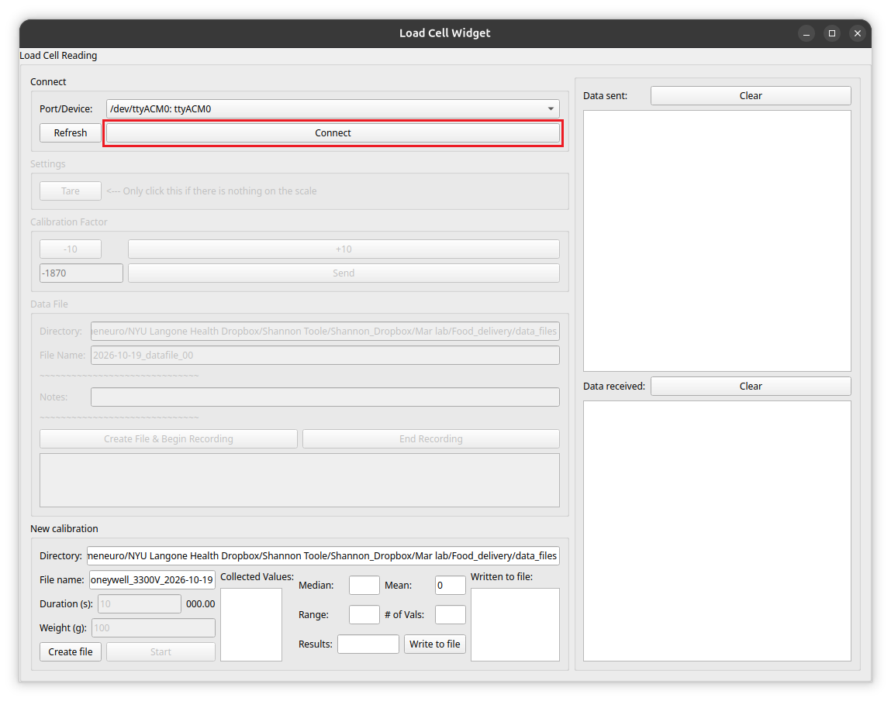
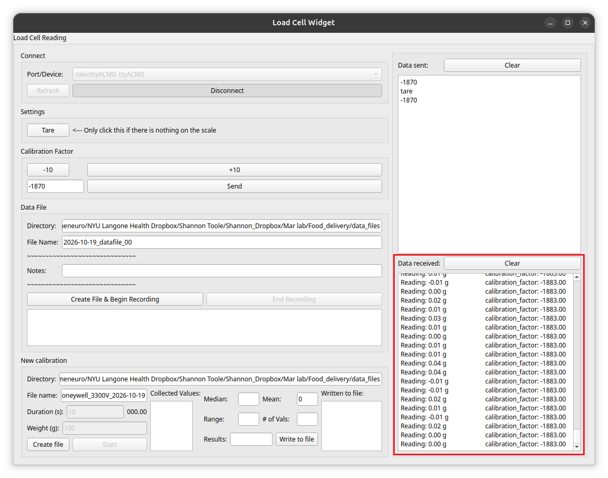

# Load cell reading

Arduino script & Python GUI for reading/recording from load cell

### Contents

- [HX711_Calibration.py](HX711_Calibration.py)
    - Python GUI for running calibrations. To be used with [HX711_Calibration_Arduino](HX711_Calibration_Arduino).
- [HX711_Estimate_Calibration_Factor](HX711_Estimte_Calibration_Factor)
    - Standalone Arduino script for estimating calibration factor. Useful when setting up a new load cell/amplifier.

<br>

---
# Setup

### [Hardware](HX711_Calibration_Arduino/README.md#hardware)

### [Firmware](HX711_Calibration_Arduino/README.md#firmware)

### [Python GUI](#software)
<br>

---
# Quick Start

## Run GUI

1. **Open command prompt/terminal**
2. **Navigate into the directory "Mar_lab-Food_delivery"**
    
    ```bash
    cd Mar_lab-Food_delivery
    ```

3. **Activate virtual environment**

    Windows:
    ```bash
    <environment_name\scripts\activate.bat
    ```
    Linux:
    ```bash
    source environment_name/bin/activate
    ```

4. **Run the python application**

    Windows:
   ```bash
   python Load_cell/HX711_Calibration.py
   ```
    Linux:
   ```bash
   python3 Load_cell/HX711_Calibration.py
   ```

<br>

---

# Usage

## Basic usage
- Open the GUI and connect to the Arduino

- Current reading and calibration factor will be displayed in the "Data received" box


## To tare:
- Remove all weight from the scale
- Click **"Tare"**
- The current reading will reset to 0.00 g

## To calibrate
- Tare the scale
- Place a known weight on the scale
- Adjust the calibration factor until the reading matches the known weight

<br>

---

# Setup

## Software

1. Open a command prompt/terminal

2. Navigate to the directory you want to store these files
   
   ```bash
   cd <folder_you_want>
   ```
   **Note:** folder name may need to be in quotes

3. Clone this repository & navigate into that folder
   ```bash
   git clone https://github.com/tooles01/Mar_lab-Food_delivery.git
   cd Mar_lab-Food_delivery
   ```

    **Note:** If git is not installed:
    - Click the green "<>Code" button above
    - Click "Download ZIP"
    - Extract the files. Copy the extracted folder into the desired directory
    - Rename the folder "Mar_lab-Food_delivery"
    - Go back to the open terminal and type in:
        ```bash
        cd Mar_lab-Food_delivery
        ```

4. Create & activate a virtual environment

    Windows:
    ```bash
    python -m venv <environment_name>
    <environment_name\scripts\activate.bat
    ```
    Linux:
    ```bash
    python3 -m venv <environment_name>
    source environment_name/bin/activate
    ```

5. Install dependencies
   ```bash
   pip install PyQt5 pyserial numpy
   ```

6. Run the application

    Windows:
   ```bash
   python Load_cell/HX711_Calibration.py
   ```
    Linux:
   ```bash
   python3 Load_cell/HX711_Calibration.py
   ```