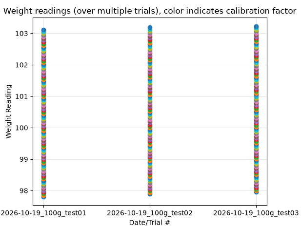
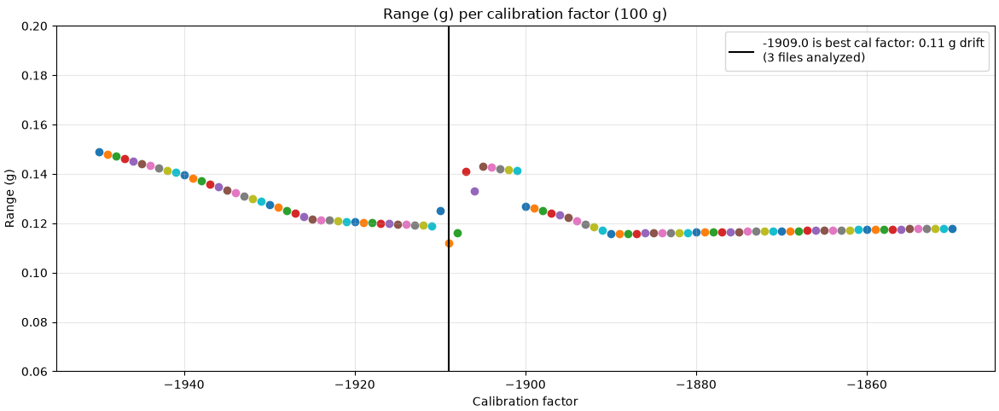
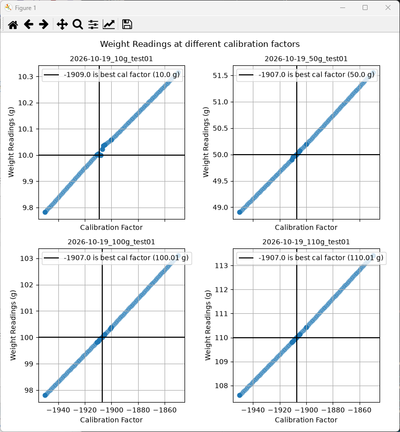

## plot_calibration_factors.py

This is for finding the ideal calibration factor at a given weight.  
Input files are data of [weight_reading, calibration_factor]


## User enters names of the files to be analyzed

```python
files = []
files.append('2026-10-12_10g_test01')
files.append('2026-10-12_50g_test01')
files.append('2026-10-12_100g_test01')
files.append('2026-10-12_110g_test01')
```


## For each file: script imports the data
File must be in .csv format and have values stored as 
[```weight_reading```, ```calibration_factor```]

### Creates a dict of data for this file

```python
this_file_data = {
    "file_name": file_name,
    "weight_readings": sorted_weight_readings,
    "calibration_factors": sorted_calibration_factors
}
```

### Interpolates the data (integers only) to get an estimated weight reading at each calibration factor
Add that to the dict

```python
this_file_data["cal_factors_interpolated"] = cal_factors_to_add
this_file_data["weights_interpolated"] = weights_interpolated
this_file_data["all_weights"] = all_weights
this_file_data["all_cal_factors"] = all_cal_factors
```

### Combine real & interpolated values and add to dict
```python
this_file_data["all_weights"] = all_weights
this_file_data["all_cal_factors"] = all_cal_factors
```

### Add this file dict to a list (that contains the data for all of the files)

```python
all_files_data.append(this_file_data)
```

## Make new dicts for calibration factor
### Reformat this to create a list of all_cal_data

#### For each calibration factor
Make a dictionary of info (from across all files)

```python
this_cal_factor_data = {"cal_factor": str(cal_factor)}
this_cal_factor_data["file_names"] = []
this_cal_factor_data["weight_readings"] = []
this_cal_factor_data["weight_range"] = []
this_cal_factor_data["drift_percent"] = []
```

### Add cal dict to a list (that contains information by calibration factor)
```python
all_cal_data.append(this_cal_factor_data)
```

## Plot by calibration factor

### For each calibration factor
#### Plot [file_names, weight_readings] (not a particularly useful plot because there are so many calibration factors)



Calculate the range of weight readings (max-min)  
Plot the range of weight readings [calibration factor, range]  
Mark the calibration factor that had the smallest range




### For each weight (file):
Plot the data  
Find the calibration factor where "weight_reading" was closest to "weight"

This is for a set of files, 1 per weight

<p align="left"> 

<!--
<br>
---
<br>

## now to plot drift over time

We want to see, at a given weight: for each calibration factor, how did the weight reading change (across files)

The processing is not exactly the same

File names will be: files across different dates but for the same weight

Data import will be the same

We need to compare data across files though
So import the data as
this_calibration_factor = {
    file_names
    weight_readings
}

it's just a reformatting of the data


after importing:
get a list of all of the calibration factors
for each calibration factor:
make a dictionary
go through 

this_calibration_factor = {
    calibration_factor = 1900
    file_names = file_names
    weight_readings = weight_readings
}

And then plot each calibration factor

For each **calibration factor**

-->