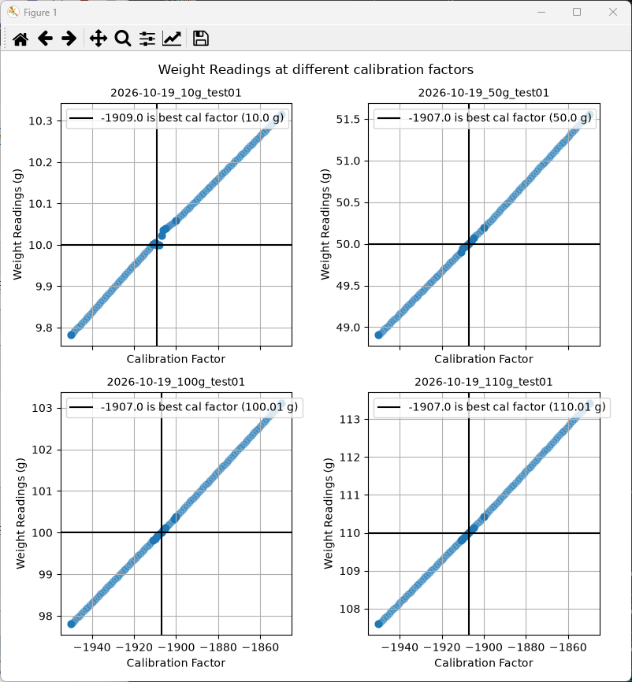

## plot_calibration_factors.py

This is for finding the ideal calibration factor at a given weight.  
Input files are data of [weight_reading, calibration_factor]

<p align="left"> 

#### User enters names of the files to be analyzed

```python
files = []
files.append('2026-10-12_10g_test01')
files.append('2026-10-12_50g_test01')
files.append('2026-10-12_100g_test01')
files.append('2026-10-12_110g_test01')
```


#### Script imports the data from each file
File must be in .csv format and have values stored as 
[```weight_reading```, ```calibration_factor```]

#### Creates a dict of data for this file

```python
this_file_data = {
    "file_name": file_name,
    "weight_readings": sorted_weight_readings,
    "calibration_factors": sorted_calibration_factors
}
```

#### Interpolates the data to get an estimated weight reading at each calibration factor
Add that to the dict also

```python
this_file_data["cal_factors_interpolated"] = cal_factors_to_add
this_file_data["weights_interpolated"] = weights_interpolated
this_file_data["all_weights"] = all_weights
this_file_data["all_cal_factors"] = all_cal_factors
```

#### Creates a list that contains the data for all of the files

```python
all_files_data.append(this_file_data)
```

<br>

---

## This is where it gets subjective

#### For each weight (file):
Plot the data  
Find the calibration factor where "weight_reading" was closest to "weight"


